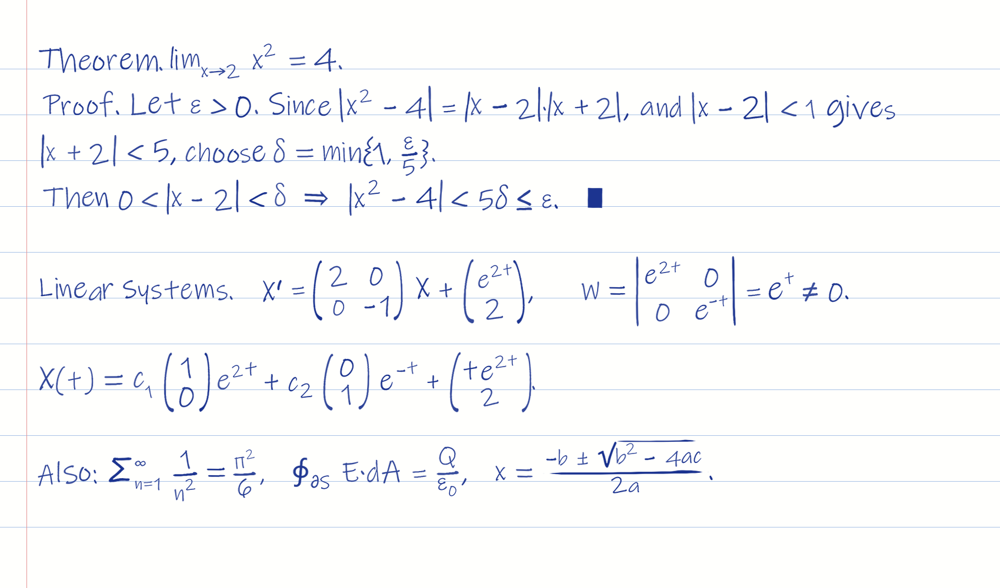

# Holograph ✍️

**Tu propia letra, tecleada.**
Escribes una plantilla una sola vez en tu tableta (Kindle Scribe, reMarkable, Boox,
iPad…) o en papel, y a partir de ahí el programa (o tu asistente de IA) convierte apuntes,
tareas y demostraciones —con matemáticas incluidas— en páginas manuscritas con tu letra.

> *holograph* (inglés) — documento escrito enteramente de puño y letra de su autor (ológrafo).


<sub>Hecho con `holograph demo` (letra simulada con una fuente del sistema). Con tus muestras se ve como tu letra.</sub>

## Qué lo hace distinto

- **Varias muestras por carácter.** Cada vez que se repite una letra se usa otra de tus
  versiones (todas por igual, nunca dos iguales seguidas) con ligeras variaciones de
  tamaño, inclinación y presión.
- **Matemáticas de verdad.** Fracciones apiladas, matrices, vectores, determinantes, raíces,
  sumatorias con límites apilados; 268 caracteres (latín, griego, ~110 símbolos) y LaTeX común.
- **Hecho para usarse con IA.** Una sola orden (`holograph`) con salida JSON y un
  [`AGENTS.md`](AGENTS.md) que enseña a Claude Code, Codex, Cursor, etc. el flujo completo.
- **Basta con un PDF.** Cada página de la plantilla lleva impreso un código; el PDF exportado
  por la tableta se reconoce solo.
- **Local y privado.** Tu letra se queda en `datos/`, que nunca se sube a git.

## Empezar

```bash
git clone https://github.com/CoriosDiAletheia/holograph.git
cd holograph
python -m pip install -r requirements.txt
python holograph.py estado
```
En Windows también puedes hacer doble clic en `instalar.bat` y luego en `iniciar.bat`.

Con un asistente de IA, abre la carpeta y pídele: «Quiero escribir con mi letra», «Importa
la plantilla que escribí», «Pasa este PDF a mi letra». Sin IA:

```bash
python holograph.py plantilla
python holograph.py importar escrito.pdf
python holograph.py escribir -f apuntes.txt -o apuntes.pdf --hoja
python holograph.py app
```
Todas las órdenes tienen nombre en inglés y en español (`status`/`estado`, `write`/`escribir`…).

Documentación: [GUIA.md](GUIA.md) (guía de uso) · [docs/FORMATO.md](docs/FORMATO.md) (formato
del texto) · [AGENTS.md](AGENTS.md) (para asistentes de IA, en inglés).

## Uso responsable

Tu letra es un dato personal: no subas tu carpeta `datos/`. Presentar como manuscrito algo
que no escribiste a mano puede ir contra las normas de tu escuela o trabajo.

## Licencia

MIT — ver [LICENSE](LICENSE). La dependencia PyMuPDF es AGPL-3.0.
