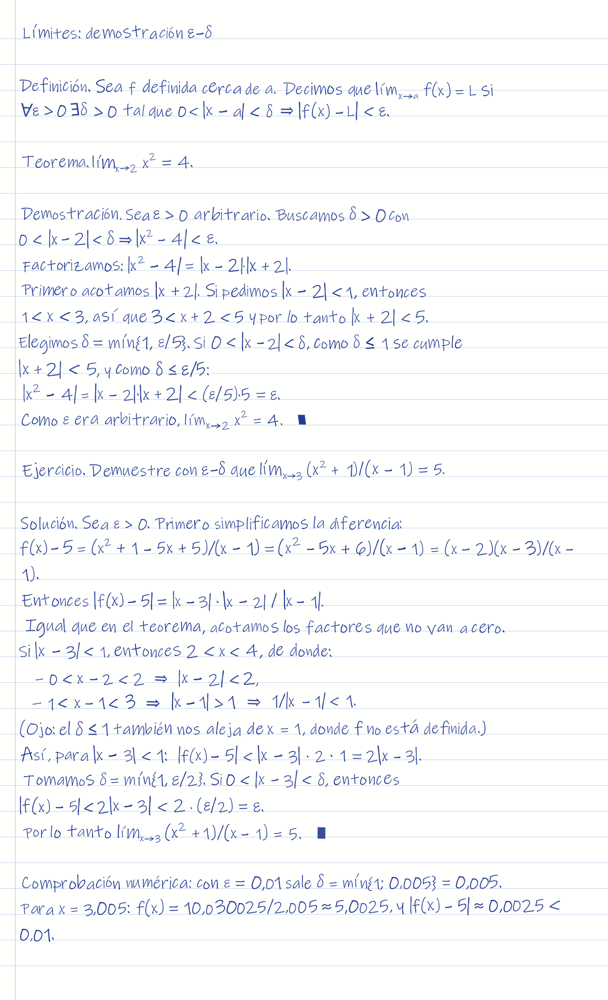

# Mi letra ✍️

**Escribe cualquier texto — incluidas matemáticas — con tu propia letra.**
Escribes una plantilla una sola vez en tu tableta (Kindle Scribe, reMarkable,
Boox, iPad…) o en papel, y a partir de ahí el programa (o tu asistente de IA)
convierte apuntes, tareas y demostraciones en páginas manuscritas con tu letra.

*English summary below.*


<sub>Ejemplo hecho con `miletra demo` (letra simulada con una fuente del sistema). Con tu letra real se ve como tu letra.</sub>

## Qué lo hace distinto

- **Varias muestras por carácter.** Cada vez que se repite una letra se usa otra de
  tus versiones (todas por igual, nunca dos iguales seguidas) con ligeras variaciones
  de tamaño, inclinación y presión. Nada de «la misma *a* siempre».
- **Matemáticas de verdad.** Fracciones apiladas, matrices, vectores, determinantes,
  raíces, sumatorias con límites apilados, 268 caracteres (latín, griego, ~110 símbolos),
  y entiende LaTeX común (`\frac`, `\begin{pmatrix}`, `\alpha`, `\int`…).
- **Hecho para usarse con IA.** Una sola orden (`miletra`) con salida JSON y un
  [`AGENTS.md`](AGENTS.md) que enseña a Claude Code, Codex, Cursor, etc. el flujo
  completo: «pasa este PDF a mi letra» y listo.
- **Basta con un PDF.** Cada página de la plantilla lleva impreso un código; el PDF
  exportado por la tableta se reconoce solo, aunque cambie de escala o de orden.
- **Local y privado.** Tu letra se queda en `datos/` en tu computadora.

## Empezar

Requisitos: Python 3.10+.

```bash
git clone https://github.com/CoriosDiAletheia/mi-letra.git
cd mi-letra
python -m pip install -r requirements.txt
python miletra.py estado
```
(En Windows también puedes hacer doble clic en `instalar.bat` y luego en `iniciar.bat`.)

### Con un asistente de IA (recomendado)

Abre la carpeta en Claude Code, Codex, Cursor o similar y pídele, por ejemplo:

> «Quiero escribir con mi letra. Prepárame la plantilla.»
> «Ya escribí la plantilla, está en Descargas/escrito.pdf. Impórtala.»
> «Pasa este PDF de la tarea a mi letra, en hojas carta y tinta azul.»

El asistente leerá `AGENTS.md` y hará el resto.

### A mano

```bash
python miletra.py plantilla             # 1. crea datos/plantilla_mi_letra.pdf
#   2. escríbela en la tableta (un carácter por casilla) y expórtala como PDF
python miletra.py importar escrito.pdf  # 3. extrae tu letra
python miletra.py escribir "∑_{n=1}^∞ \frac{1}{n^2} = \frac{π^2}{6}" -o formula.png
python miletra.py escribir -f apuntes.txt -o apuntes.pdf --hoja
python miletra.py app                   # interfaz gráfica
```
¿Sin tableta todavía? `python miletra.py demo` crea una letra de prueba.

Documentación: [GUIA.md](GUIA.md) (uso detallado) · [docs/FORMATO.md](docs/FORMATO.md)
(sintaxis del texto) · [AGENTS.md](AGENTS.md) (para asistentes de IA).

## Uso responsable

Tu letra es un dato personal: no subas tu carpeta `datos/` a ningún sitio.
Usa la herramienta para tus propios textos; presentar como manuscrito algo que
no escribiste a mano puede ir contra las normas de tu escuela o trabajo.

## Proyectos relacionados

- [Calligraphr](https://www.calligraphr.com/) (comercial) y
  [handwrite](https://github.com/builtree/handwrite) convierten una hoja de muestras
  en una fuente `.ttf`.
- [Handwright](https://williamzujkowski.github.io/posts/2026-03-09-handwright-paper-to-font)
  hace lo mismo y tiene las variantes por carácter como tarea pendiente.
- Los generadores «text to handwriting» suelen usar fuentes fijas y no maquetan matemáticas.

---

## English summary

**Mi letra** turns any text — including math — into pages written in *your own*
handwriting. You fill in a template once on an e-ink tablet (or paper); the tool
extracts several samples per character and composes new text with them, picking a
different sample each time and adding natural jitter. It lays out fractions,
matrices, determinants and stacked limits, understands common LaTeX, and ships with
an [`AGENTS.md`](AGENTS.md) so coding agents (Claude Code, Codex, Cursor…) can run
the whole workflow for you ("convert this PDF into my handwriting"). The UI and docs
are in Spanish; the CLI is `python miletra.py <command> --json`.

## Licencia

MIT — ver [LICENSE](LICENSE).
