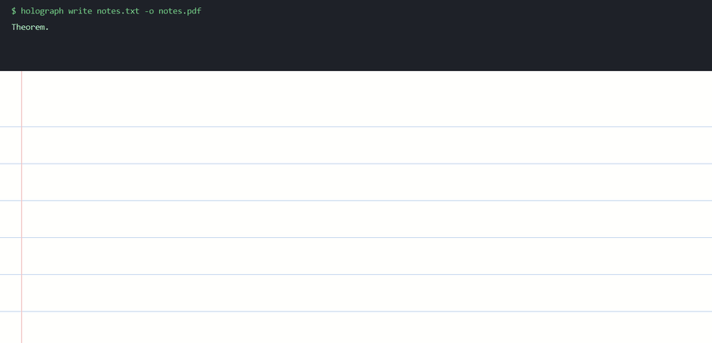
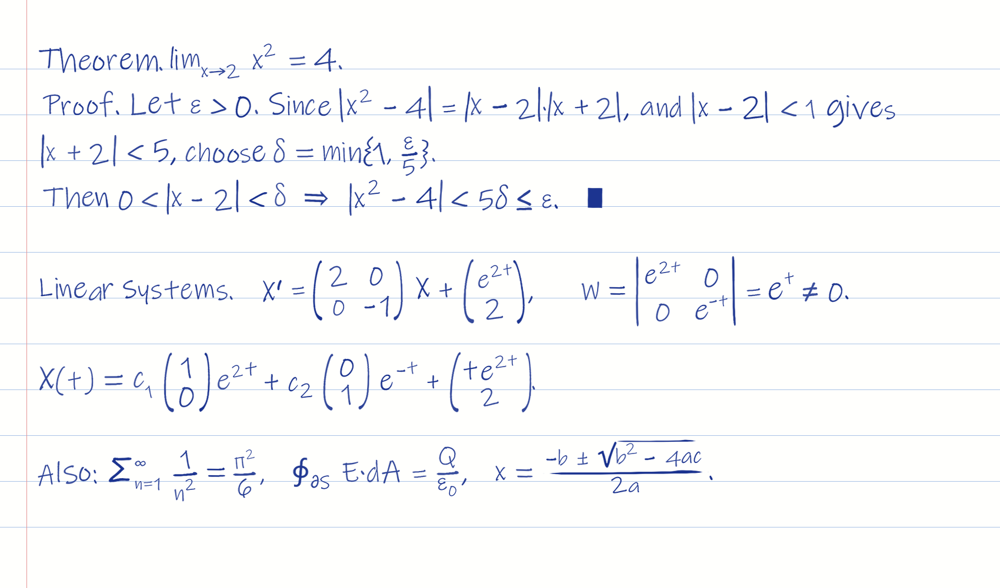

# Holograph ✍️

**Your own handwriting, typed.**
Fill in a template once — on an e-ink tablet or on paper — and from then on any text,
*math included*, comes out as pages written in your hand. Lecture notes, problem sets,
proofs with matrices and integrals: type them (or let your AI assistant do it) and get
them back in your handwriting.


<sub>Rendered with the built-in **demo** handwriting (`holograph demo`, simulated from a system font) so you can try everything before writing a single letter. With your own samples, it looks like *you*.</sub>

> *holograph* (n.) — a document written entirely in the handwriting of its author.

## Why it's different

- **It never repeats itself.** You write several samples of every character. Each time a
  letter appears, Holograph picks one of *your* versions — every sample gets used before any
  repeats, never the same one twice in a row — and adds slight natural jitter in size, slant,
  baseline and pen pressure. No more "the same *a* everywhere" look of handwriting fonts.
- **Real math layout, in your hand.** Stacked fractions, matrices and column vectors,
  determinants, square roots, sums and integrals with stacked limits, sub/superscripts.
  268 characters out of the box (Latin, Greek, ~110 math symbols), and it understands
  everyday LaTeX: `\frac`, `\begin{pmatrix}`, `\alpha`, `\int_0^\infty`, `\mathbb{R}`, `$…$`.
  Brackets, fraction bars and radicals are stretched from your own strokes.
- **Made to be driven by AI agents.** One CLI with JSON output, a `status` command that says
  what to do next, a `validate` command to check markup, `--preview` images to inspect the
  result, and an [`AGENTS.md`](AGENTS.md) that teaches Claude Code, Codex, Cursor & co. the whole
  workflow. Ask *"turn this PDF into my handwriting"* and it does the transcription for you.
- **One PDF is enough.** Every template page carries a printed code (template id + page
  number) and registration marks, so the PDF exported from your tablet is recognized on its
  own — even if pages are rescaled, reordered or missing.
- **Local and private.** Your handwriting never leaves your computer; it lives in `datos/`,
  which is git-ignored.

## How it works

```
 1. holograph template   →  PDF with labeled boxes (one character per box, guide lines)
 2. you write on it      →  Kindle Scribe, reMarkable, Boox, iPad… or print & scan
 3. holograph import     →  aligns pages, reads the codes, cuts out every glyph
 4. holograph write      →  lays out your text + formulas with your glyphs → PDF / PNG
```

## Quick start

Requires Python 3.10+ (Windows, macOS or Linux).

```bash
git clone https://github.com/CoriosDiAletheia/holograph.git
cd holograph
python -m pip install -r requirements.txt
python holograph.py status
```

Try it immediately with the demo handwriting:

```bash
python holograph.py demo
python holograph.py write --hand demo "\sum_{n=1}^\infty \frac{1}{n^2} = \frac{\pi^2}{6}" -o test.png
```

### With an AI assistant (recommended)

Open the folder in Claude Code, Codex, Cursor or any agent that can run commands, and just ask:

> *"I want to write with my own handwriting — set me up."*
> *"I filled in the template, it's in Downloads/written.pdf. Import it."*
> *"Turn this homework PDF into my handwriting, letter-size pages, blue ink."*

The agent reads [`AGENTS.md`](AGENTS.md), checks `holograph status`, and takes it from there —
including transcribing a PDF's matrices and fractions into Holograph's markup.

### By hand

```bash
python holograph.py template                 # 1. creates datos/plantilla_mi_letra.pdf
#   2. write on it (one character per box) and export it as a PDF
python holograph.py import written.pdf       # 3. extract your handwriting
python holograph.py review                   #    contact sheet of every sample
python holograph.py write -f notes.txt -o notes.pdf --sheet --preview
python holograph.py app                      # graphical interface
```
`pip install -e .` also puts a `holograph` command on your PATH.

## Example output



## The text format in 20 seconds

| You type | You get |
|---|---|
| `x^2`, `e^{2t}`, `a_n`, `x_i^2` | super/subscripts (stacked when both) |
| `\sum_{n=1}^\infty`, `\lim_{x \to 0}` | limits below and above, as written by hand |
| `\frac{a}{b}` | stacked fraction |
| `\pmat{a & b ; c & d}`, `\pmat{1 ; 0}` | matrix / column vector (`\bmat`, `\vmat` for [ ] and | \|) |
| `\sqrt{b^2 - 4ac}` | radical with a bar |
| `\alpha \leq \int \infty \mathbb{R}` or `α ≤ ∫ ∞ ℝ` | LaTeX names or plain Unicode |

Full reference: [`docs/FORMAT.md`](docs/FORMAT.md).

## Commands

| Command | What it does |
|---|---|
| `status` | current stage (`sin_letra` → `esperando_pdf_escrito` → `lista`) and the next step |
| `template [--sets …]` | template PDF; choose character sets and samples per character |
| `import WRITTEN.pdf` | extract handwriting from the filled-in PDF |
| `review` | contact sheet of all samples (discard bad ones) |
| `chars` | characters you have, derived ones, missing ones |
| `validate FILE` | check markup and characters without samples |
| `write (TEXT \| -f FILE \| stdin) -o OUT` | render `.pdf`/`.png`: `--sheet --preview --size --color --paper --word-spacing --messiness --slant --seed` |
| `demo` | sample handwriting, no tablet needed |
| `export hand.zip` | back up your handwriting |
| `app` | desktop GUI |

All commands accept `--json`. Every command also has a Spanish alias (`estado`, `escribir`, …).

## Language note

The project was born in Spanish: the GUI, CLI messages, JSON keys, code comments and the
detailed user guide ([`GUIA.md`](GUIA.md)) are in Spanish, while this README, [`AGENTS.md`](AGENTS.md)
and [`docs/FORMAT.md`](docs/FORMAT.md) are in English. AI agents handle both seamlessly.
Versión en español: [README.es.md](README.es.md).

## Responsible use

Your handwriting is personal data — never upload your `datos/` folder. Use Holograph for your
own texts; submitting machine-written pages as handwritten work may break your school's or
employer's rules.

## Related projects

- [Calligraphr](https://www.calligraphr.com/) (commercial) and [handwrite](https://github.com/builtree/handwrite)
  turn a sample sheet into a `.ttf` font — one glyph per character.
- [Handwright](https://williamzujkowski.github.io/posts/2026-03-09-handwright-paper-to-font) does the same
  and lists multiple variants per character as future work.
- "Text to handwriting" web tools typically use fixed fonts and struggle with equations.

## License

Copyright © 2026 CoriosDiAletheia and contributors.
Licensed under the [GNU AGPL-3.0](LICENSE) (or any later version) — the same license as its PDF engine, [PyMuPDF](https://pymupdf.readthedocs.io/).
You can use, study, modify and share Holograph freely. If you distribute a modified version, or
offer it to others as a web service, you must publish your source code under the same license.
